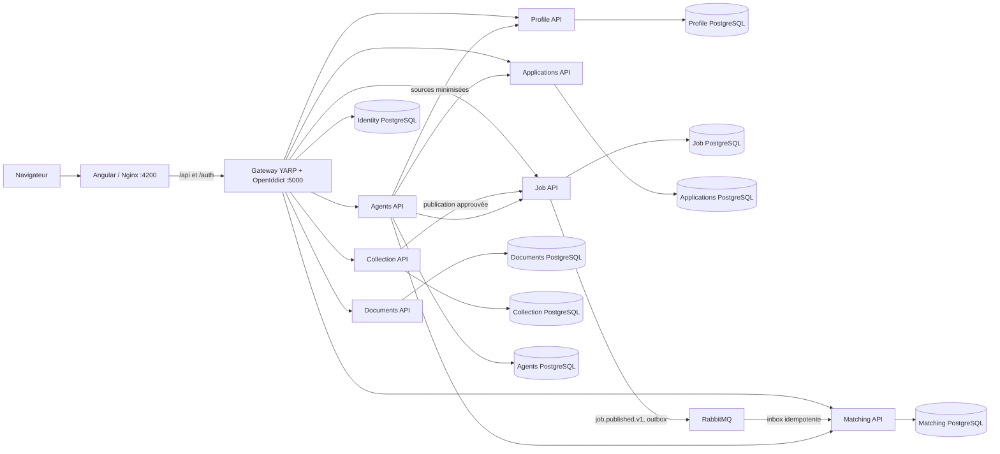

# Architecture locale

JobApplicationAgent est une application locale composée d'une interface Angular, d'un Gateway BFF/OIDC et de microservices métier. Chaque service persistant garde sa propre base PostgreSQL. Le Gateway est l'unique entrée du navigateur en mode Compose complet.

Le navigateur conserve une session cookie HttpOnly gérée par le Gateway. Les API valident les jetons d'accès OIDC et appliquent leur propre contrôle de propriétaire. Les workers RabbitMQ et les traitements Agents restent soumis à leur configuration et sont désactivés par défaut lorsque le déploiement ne les active pas. En développement Compose, les clés OIDC sont éphémères : un redémarrage du Gateway invalide les jetons existants, et l'utilisateur doit se reconnecter.

Le démarrage Compose complet publie uniquement des ports liés à `127.0.0.1`. La topologie et ses variables sont définies dans les fichiers `docker-compose*.yml`; le guide [installation Windows](windows-install.md) décrit leur démarrage.
