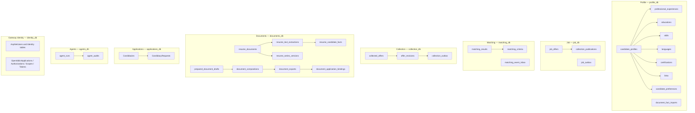

# Schémas PostgreSQL

Chaque microservice persistant possède son propre `DbContext`, sa base et son historique EF Core `__EFMigrationsHistory`. Les relations entre services passent par HTTP ou événements ; aucune clé étrangère ne relie deux bases différentes. Cette page résume le modèle courant. Les snapshots EF et les fichiers de migration listés sous chaque projet restent la source exacte des colonnes, types, index, contraintes et relations.

| Base / port hôte Compose | Tables principales | Historique de migrations courant |
| --- | --- | --- |
| Profile `profile_db` / 5432 | `candidate_profiles`, `professional_experiences`, `educations`, `skills`, `languages`, `certifications`, `links`, `candidate_preferences`, `document_fact_imports` | 11 migrations ; `ProfileDbContextModelSnapshot` |
| Job `job_db` / 5433 | `job_offers`, `collection_publications`, `job_outbox` | 5 migrations réparties entre `Migrations` et `Persistence/Migrations` ; le premier lot crée `job_offers`, le suivant fait évoluer son schéma |
| Matching `matching_db` / 5434 | `matching_results`, `matching_criteria`, `matching_event_inbox` | 3 migrations ; `MatchingDbContextModelSnapshot` |
| Collection `collection_db` / 5435 | `collected_offers`, `offer_revisions`, `collection_outbox` | 5 migrations ; `CollectionDbContextModelSnapshot` |
| Documents `documents_db` / 5436 | `resume_documents`, `resume_text_extractions`, `resume_candidate_facts`, `resume_series`, `resume_series_versions`, `prepared_document_drafts`, `document_compositions`, `document_exports`, `document_application_bindings` | 9 migrations ; `DocumentsDbContextModelSnapshot` |
| Applications `applications_db` / 5437 | `Candidacies`, `CandidacyRequests` | 3 migrations ; `ApplicationsDbContextModelSnapshot` |
| Agents `agents_db` / 5438 | `agent_runs`, `agent_audits` | 1 migration ; `AgentsDbContextModelSnapshot` |
| Identity `identity_db` / 5439 | `AspNetUsers`, rôles et claims Identity ; tables `OpenIddictApplications`, `OpenIddictAuthorizations`, `OpenIddictScopes`, `OpenIddictTokens` | 2 migrations ; `GatewayIdentityDbContextModelSnapshot` |

Les ports sont liés à `127.0.0.1`. Les noms/identifiants de Compose ne remplacent pas la configuration des services. Certaines bases ont des valeurs locales de développement dans le Compose historique ; les overlays plus récents exigent des variables locales. Voir [l'installation Windows](windows-install.md) et les guides par service avant de connecter un outil externe.
